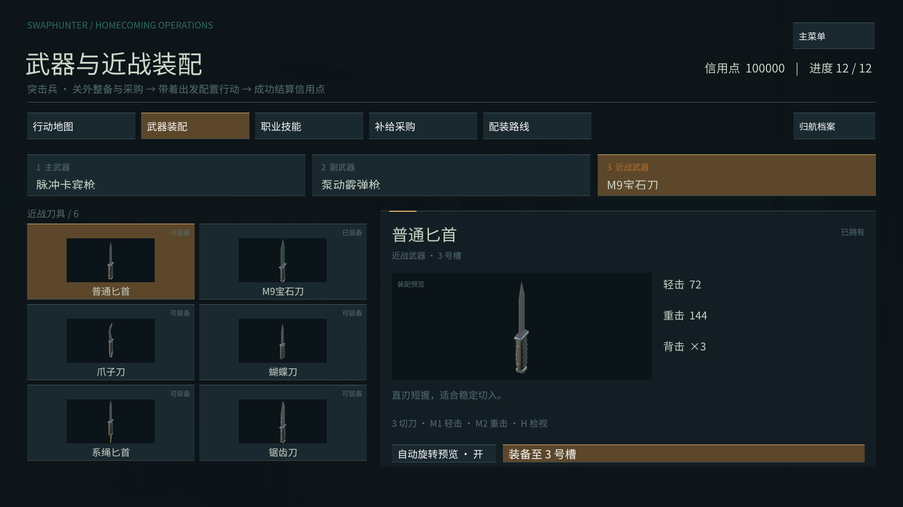
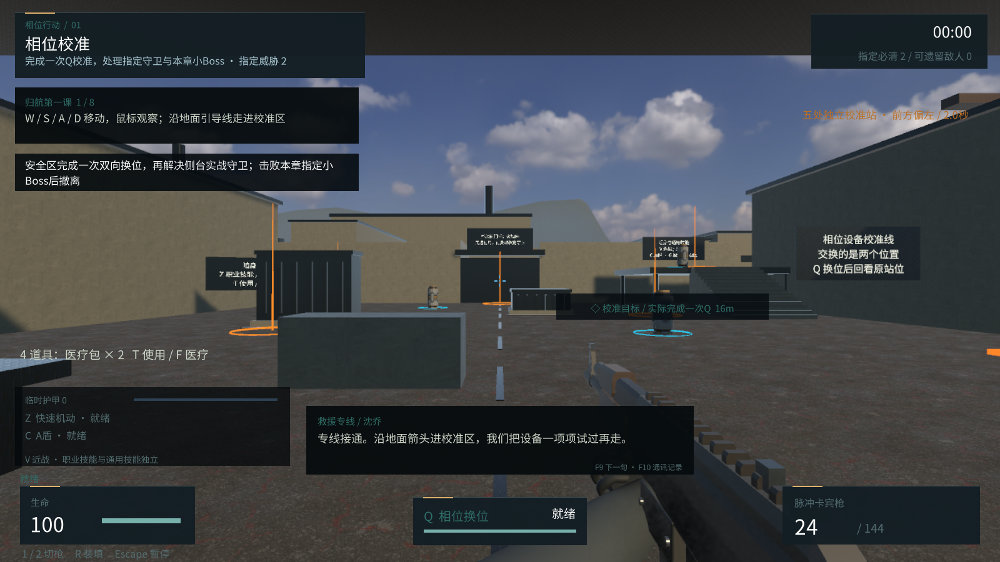

# 换位猎手 / SwapHunter

**以双向位置交换为核心机制的离线单人 FPS，基于 Unity 6 与 C# 开发。**

项目将射击、空间换位、职业技能与关卡目标结合：玩家通过改变双方位置重组射界、掩体关系和危险承担者，在资源约束下完成任务并撤离。系统覆盖关外配装、关内战斗、剧情推进与成长结算，重点关注规则一致性、敌人行为反馈和可追溯的状态管理。

当前源码对应 **2026-10-20 归航行动更新**，包含 12 个章节、4 个职业、8 项职业技能、12 把枪械与 6 款近战刀具。[下载 v0.7.0 Windows 试玩包](https://github.com/s1encisi/SwapHunter/releases/download/v0.7.0/SwapHunter-v0.7.0-Windows-x64.zip) · [系统设计文档](https://github.com/s1encisi/SwapHunter/releases/download/v0.7.0/SwapHunter-System-Design-v0.7.0.docx) · [Release 说明](https://github.com/s1encisi/SwapHunter/releases/tag/v0.7.0)。


## 核心系统

| 系统 | 已实现内容 | 设计重点 |
|---|---|---|
| 双向换位 | 交换玩家与目标的位置，保留各自生命、装备和朝向；准备结束后复查视线、净空与干扰 | 双端执行、失败回滚与冷却提交分离，保持空间规则可预测 |
| 章节与剧情 | 12 章归航行动；第 1 章整合基础教学，第 12 章为最终 Boss 战；每章配置小 Boss，归航档案按时间线收录故事 | 将教学、任务与叙事编排到同一行动流程；主目标、指定威胁和撤离条件分别判定 |
| 职业与成长 | 突击、重装、侦查、远程 4 个职业；每职业 2 项技能，职业技能及通用技能支持三级成长 | 共享已拥有资产，按职业保存合法配装，通过商店与关卡收益形成成长循环 |
| 武器与配装 | 12 把枪械、6 款刀具；统一主武器、副武器、近战武器 3 槽装配页，支持模型自动旋转预览 | 装配、出发快照和实战模型读取一致的装备选择；按武器类型组织握持、装填和检视动作 |
| 道具与路线 | 医疗、弹药、护甲 3 类道具；2 个槽位每槽最多携带 3 件，两槽可配置相同或不同类型 | 采购库存与行动消耗分开管理；路线说明交代装备分工、适用场景和操作顺序 |
| 敌人 AI 与部署 | 听声调查、视线记忆、追击搜索、掩体选择、侧向调整、护盾绕行与危险回避 | 决策依据已感知信息；出生位置校验导航可达性、空间净空、单位间距和预警时长 |
| 视听与交互 | 枪械分型射击及机械音效，区分爆头与普通命中反馈；下拉式多选设置与动态按键提示 | 31 项可绑定动作驱动操作与提示文字，统一 HUD、教学、场景提示及剧情操作 |

主界面保留「开始行动」「设置」「退出游戏」三个入口。第 1、12 章集中调整地图与流程，第 2—11 章保留主要任务和地图结构并补充衔接剧情。

## 运行画面

| 统一武器与近战装配 | 第 1 章剧情教学与战斗 HUD |
|---|---|
|  |  |

以上为 2026-10-20 原生游戏窗口采集；装配页资产和资金来自隔离测试档。主菜单背景为概念插画，关卡截图展示实际运行画面。角色、武器与场景仍采用原型级美术资产。

## 技术实现

| 模块 | 技术与实现入口 |
|---|---|
| 引擎与渲染 | Unity **6000.3.25f1**、C#、URP **17.3.0**、glTFast **6.15.0** |
| 输入与界面 | Input System **1.14.2**、IMGUI；[GameOptions](Game/Assets/_SwapHunter/Scripts/GameOptions.cs)、[KeyHints](Game/Assets/_SwapHunter/Scripts/KeyHints.cs)、[SettingsDropdown](Game/Assets/_SwapHunter/Scripts/SettingsDropdown.cs) |
| 换位与战斗 | CharacterController 与物理查询；[PlayerMotor](Game/Assets/_SwapHunter/Scripts/PlayerMotor.cs)、[SwapValidationResult](Game/Assets/_SwapHunter/Scripts/SwapValidationResult.cs) |
| 导航与 AI | AI Navigation **2.0.9**、显式状态机、感知记忆与路径校验；[EnemyTacticalAI](Game/Assets/_SwapHunter/Scripts/EnemyTacticalAI.cs)、[EnemyHazardAwareness](Game/Assets/_SwapHunter/Scripts/EnemyHazardAwareness.cs)、[EnemyMotion](Game/Assets/_SwapHunter/Scripts/EnemyMotion.cs) |
| 任务与遭遇 | 配置驱动的目标、触发和预算管理；[MissionRuntime](Game/Assets/_SwapHunter/Scripts/MissionRuntime.cs)、[FairDeployment](Game/Assets/_SwapHunter/Scripts/FairDeployment.cs)、[MapV2World](Game/Assets/_SwapHunter/Scripts/MapV2World.cs)、[FocusedWorld](Game/Assets/_SwapHunter/Scripts/FocusedWorld.cs) |
| 表现与叙事 | 骨骼动画、握点绑定、武器动作与事件音频；[PlayerWeaponPresentation](Game/Assets/_SwapHunter/Scripts/PlayerWeaponPresentation.cs)、[StoryRuntime](Game/Assets/_SwapHunter/Scripts/StoryRuntime.cs)、[StoryArchiveContent](Game/Assets/_SwapHunter/Scripts/StoryArchiveContent.cs) |
| 数据与工具 | JSON 存档、原子替换与备份、行动快照、幂等结算收据；PowerShell 构建与专项检查工具、Python/Blender 资源处理管线 |

关键实现约束：

- **换位事务**：目标预览、请求验证、末端复查、双端移动和回滚分别处理，防止单侧移动或失败扣除成功冷却。
- **遭遇预算**：待触发、预警、已部署与取消分别记账；非法出生位置延期部署，固定塔位保持原有高度约束。
- **感知驱动 AI**：敌人根据视线、枪声和队友共享的采样位置更新记忆，失去目标后搜索；射击受真实遮挡和弹丸碰撞约束。
- **成长结算**：出发时冻结配装与库存快照，成功时结算实际消耗；死亡重试或退出恢复出发状态，结算收据防止重复奖励。

## 从源码运行

1. 克隆仓库，使用 Unity Hub 打开 **Game** 目录，编辑器版本为 **6000.3.25f1**。
2. 等待依赖与资产导入，打开 `Assets/_SwapHunter/Scenes/SwapHunter.unity`，进入 Play。地图在运行时构建。
3. Windows 构建需安装对应的 Windows x64 构建支持，在仓库根目录执行：

```powershell
.\Tools\Build-Demo-v06.ps1 `
  -EditorPath 'C:\Program Files\Unity\Hub\Editor\6000.3.25f1\Editor\Unity.exe' `
  -OutputDirectory 'Builds/SwapHunter-current'
```

输出目录须为空。构建工具记录源码与程序集身份，保留已有构建；普通打开与构建无需 Node.js 或 Blender。当前发布版本为 `0.7.0`，具体源码提交与构建身份记录在 `build-identity.json`。

独立演示模式可在构建目录运行：

```powershell
.\SwapHunter.exe -swapHunterTacticalDemo -demoAllUnlocked -demoLevel 1 -demoMenu
.\SwapHunter.exe -swapHunterTacticalDemo -demoLevel 12 -demoClass 0 -demoSkill 1
```

全内容演示使用独立临时目录，预置章节、剧情、资产与技能供浏览，不写入正式成长。章节编号为 1—12；职业编号 0—3 依次对应突击、重装、侦查、远程；技能编号为 0/1。

## 验证与设计资料

原生专项检查已覆盖六款刀具的装配与出战同步、枪械装填和动作采样、自定义键位与剧情输入、首尾章节路线，以及敌人听声调查、远距离追击、真实弹丸伤害、换位后搜索、护盾绕行和危险回避。各项结果对应各自候选构建与测试范围。

设置下拉项的展开状态与键盘选择已有专项证据；物理鼠标点击展开尚未完成实测。自动化场景验证不等同于真人全流程通关或主观手感评价。

- [当前版本与验证范围](docs/current-state-2026-10-20.zh-CN.md)
- [早期系统设计与成长规则](docs/tactical-design.zh-CN.md) · [系统协同设计历史方案](docs/system-synergy-upgrade.zh-CN.md)
- [模型接入与资源管线](docs/models-final.zh-CN.md) · [地图与敌人系统验证](docs/maps-enemies-v2-validation.zh-CN.md)

历史设计和验证文档保留对应阶段的规则与结果；当前功能及调整以最新版本说明和源码为准。

## 个人贡献与资源许可

项目作者负责核心玩法构思、系统与战斗规则设计、关卡及剧情需求、交互调整要求和方案决策。代码实现、资源转换工具及部分文档整理采用 AI 辅助开发；外部模型与音频保留原作者归属。个人贡献主要体现在需求拆解、玩法约束与系统关系设计、迭代方向制定。

项目自有代码、文档、程序化几何与合成音效采用 [MIT License](LICENSE)。Quaternius、Kenney 等模型、纹理和部分音频按各自 CC0 许可使用；本轮枪声音源包含 Michel Baradari 的 **CC BY 3.0** 资源，装填音源来自 SpringySpringo 的 CC0 资源，详见[音效署名与处理说明](Game/Assets/_SwapHunter/Resources/Audio/Refinement/CREDITS.txt)。

完整来源、许可、转换记录与文件哈希见[第三方资源台账](THIRD_PARTY_ASSETS.md)、[第三方声明](THIRD_PARTY_NOTICES.md)及 [VisualAuthoring](Tools/VisualAuthoring/README.md)。
