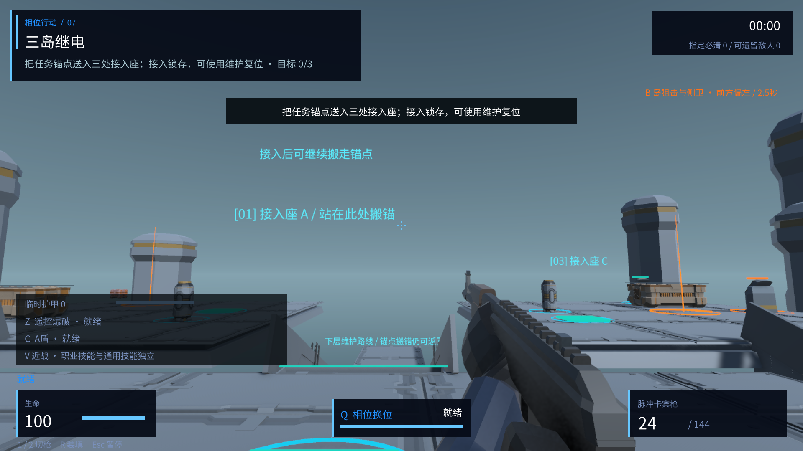
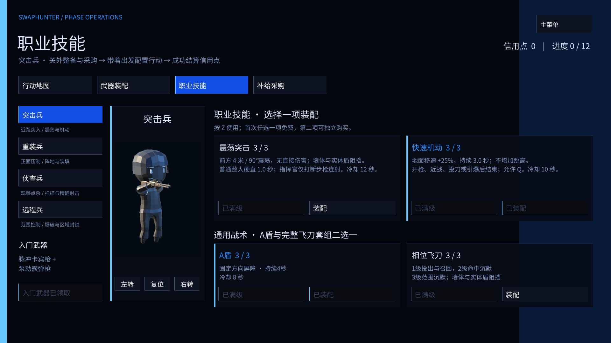
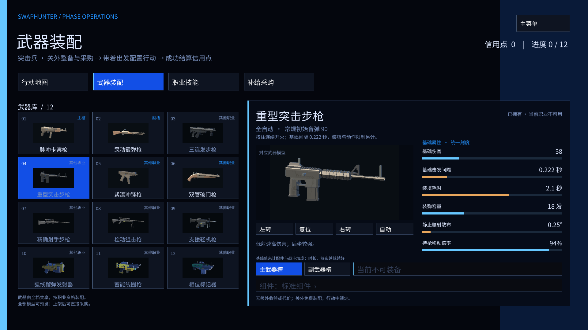

# 换位猎手 · SwapHunter

**以位置交换为核心玩法的 Unity 单人战术 FPS。**

瞄准敌人或场景锚点，交换双方的位置：绕开正面护盾、抢占高处射界，或把敌人留在即将爆炸的手雷旁。换位保留双方的朝向、生命和装备，玩家需要结合射击、职业技能与场景布局完成任务。

项目包含 **12 个章节、4 种职业、12 把武器**，从出发前的配装、战斗中的空间决策，到撤离后的采购与技能成长，组成完整的单人行动流程。

[下载 Windows 试玩版](https://github.com/s1encisi/SwapHunter/releases/download/v0.6.0/SwapHunter-v0.6.0-Windows-x64.zip) · [玩法指南](docs/tactical-playguide.zh-CN.md) · [从源码运行](#从源码运行)

## 游戏画面



| 职业与技能 | 武器图鉴与装配 |
|---|---|
|  |  |

## 核心玩法

- **用换位改变战局。** 地面与空中均可发起换位，利用掩体、朝向和高低差重新组织进攻；手雷与场景危险留在原处，换位也能改变谁来承担风险。
- **围绕目标完成关卡。** 十二章覆盖突破盾线、夺取制高点、搬运锚点、切断增援和 Boss 争位。主目标、指定威胁与撤离条件分别判断，玩家可以选择完成任务后脱战。
- **四职业提供不同打法。** 突击兵侧重近距离突入与机动，重装兵侧重阵地与装填，侦查兵侧重信息与精确射击，远程兵侧重爆破与区域控制。每种职业有两项专属技能，技能支持三级成长。
- **出发前规划装备。** 各职业独立保存双枪、配件和技能配置，共享武器与补给库存。行动中可使用定向护盾或可召回飞刀，并按需要携带医疗、弹药、护甲补给。
- **武器差异直接可见。** 十二把武器涵盖自动射击、霰弹、三连发、栓动、榴弹与蓄能等机制；装配页提供可旋转模型，以及伤害、击发间隔、装填、容量、散布和移动倍率的对比。

## 技术实现

基于 **Unity 6、C# 和 URP**，使用 Input System 处理输入，AI Navigation 支持敌人导航，glTFast 加载模型资源。

| 模块 | 实现要点 | 主要代码 |
|---|---|---|
| 双端换位 | 请求与执行分离，在前摇结束后复查视线、两端站立空间和局部干扰；执行失败时回滚位置，成功后进入冷却 | [PlayerMotor](Game/Assets/_SwapHunter/Scripts/PlayerMotor.cs)、[SwapValidationResult](Game/Assets/_SwapHunter/Scripts/SwapValidationResult.cs) |
| 关卡与遭遇 | 用任务配置组织目标、敌人预算、触发与警报；主目标、必清对象和撤离资格独立计算 | [MissionRuntime](Game/Assets/_SwapHunter/Scripts/MissionRuntime.cs)、[MissionConfiguration](Game/Assets/_SwapHunter/Resources/MissionConfiguration.asset) |
| 职业与战斗 | 职业资格、武器装配和技能成长统一由规则层约束；技能效果接入实际移动、装填与伤害计算 | [TacticalPrototypeRules](Game/Assets/_SwapHunter/Scripts/TacticalPrototypeRules.cs)、[PlayerClassSkill](Game/Assets/_SwapHunter/Scripts/PlayerClassSkill.cs) |
| 行动与存档 | 出发时冻结装备和补给快照，撤离时结算实际消耗；以行动 ID 避免重复发奖，文件写入采用原子替换与备份 | [ExpeditionData](Game/Assets/_SwapHunter/Scripts/ExpeditionData.cs)、[ExpeditionRun](Game/Assets/_SwapHunter/Scripts/ExpeditionRun.cs) |
| 模型与动画 | 角色骨骼动画、武器握点与活动部件绑定；武器图鉴和第一人称持枪共用模型资源 | [ActorVisualRig](Game/Assets/_SwapHunter/Scripts/ActorVisualRig.cs)、[PlayerWeaponPresentation](Game/Assets/_SwapHunter/Scripts/PlayerWeaponPresentation.cs) |

## 开始游玩

下载并完整解压 [Windows x64 试玩包](https://github.com/s1encisi/SwapHunter/releases/tag/v0.6.0)，运行 `SwapHunter.exe`。首次进入可领取入门武器、职业技能与通用技能，然后开始第一章。

想直接体验职业、武器和章节，可运行包内的 `快速体验.cmd`。它使用独立演示存档，预置全武器与三级技能，不影响正常游戏进度。

| 操作 | 按键 | 操作 | 按键 |
|---|---|---|---|
| 移动 / 观察 | WASD / 鼠标 | 射击 / 瞄准 | 鼠标左键 / 右键 |
| 跳跃 / 冲刺 | Space / 左 Shift | 换位 / 交互 | Q / E |
| 装填 / 切换武器 | R / 1、2、滚轮 | 职业技能 | Z |
| 定向护盾 | C | 飞刀投掷 / 召回 | G / X |
| 背包 / 暂停 | Tab / Esc | 医疗包 | F |

护盾与飞刀需要先在通用技能槽中装备。完整技能、配装和任务规则见[玩法指南](docs/tactical-playguide.zh-CN.md)。

## 从源码运行

- Unity **6000.3.25f1**，Windows x64 构建支持。
- 包版本：URP **17.3.0**、Input System **1.14.2**、AI Navigation **2.0.9**、glTFast **6.15.0**。

1. 在 Unity Hub 中打开仓库的 `Game` 目录，等待依赖和资源导入。
2. 打开 `Assets/_SwapHunter/Scenes/SwapHunter.unity`，进入 Play。地图在运行时生成。
3. 构建 Windows 版本时，在仓库根目录执行以下命令，将编辑器路径替换为本机路径：

```powershell
.\Tools\Build-Demo-v06.ps1 -EditorPath 'C:\Program Files\Unity\Hub\Editor\6000.3.25f1\Editor\Unity.exe'
```

默认输出为 `Builds/SwapHunter-v0.6.0`。目录已存在时，用 `-OutputDirectory` 指定新的输出位置。常规运行和构建不需要 Blender 或 Node.js。

## 许可

项目代码采用 [MIT License](LICENSE)。第三方模型、纹理、字体和依赖的许可见[第三方声明](THIRD_PARTY_NOTICES.md)与[素材清单](THIRD_PARTY_ASSETS.md)。

