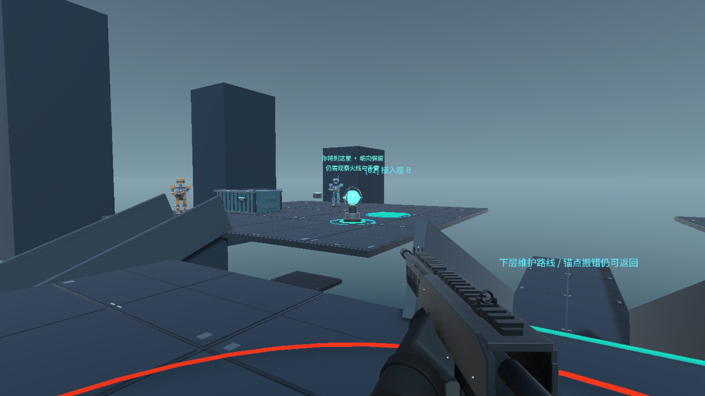
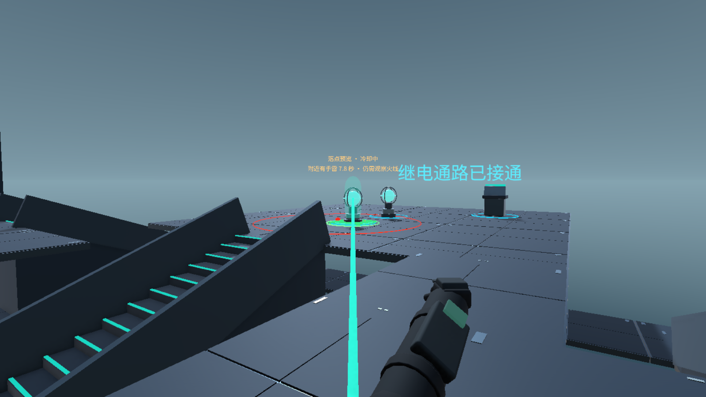

# 换位猎手 / SwapHunter

**通过交换双方的位置，改变射界、掩体与危险承担者的离线单人 FPS。** 玩家保持各自的生命、装备和朝向，用射击、换位、定向护盾与飞刀完成空间任务。

当前源码已包含 **四职业、八项职业技能、三级技能成长、共享商店、三类道具与行动快照**。普通启动使用独立 v6 档；旧 v4 和 T01 v5 档案保留，迁移工具只预览明确选定的副本。

武器页保留十二把图标、可旋转模型、数字与属性条；四职业、普通敌人、George 机甲 Boss、第一人称双臂和十二把枪已切换到新模型，场景模型覆盖十二章与经典/教学区域。人物使用真实骨架动作，枪械通过握点和活动部件绑定。[新模型版本说明](docs/models-final.zh-CN.md)与[资源台账](THIRD_PARTY_ASSETS.md)说明范围、设计取舍和素材来源；先前的[战术系统验收](docs/tactical-validation.zh-CN.md)作为历史基线保留。

## 从哪里开始

- **直接试玩**：Windows 包完整解压后运行 `SwapHunter.exe`，正常开局领取入门武器、任选职业技能和盾/刀通用技能。
- **快速浏览作品**：双击 Windows 包中的 `快速体验.cmd`，使用独立演示档浏览四职业、全武器及章节。先看第 5、7、12 章。
- **操作与成长**：[完整中文玩法指南](docs/tactical-playguide.zh-CN.md)。
- **理解实现与取舍**：[系统设计](docs/tactical-design.zh-CN.md)、[经济路径](docs/tactical-economy.zh-CN.md)。
- **准备项目讲述**：[讲解结构与技术追问](docs/tactical-interview.zh-CN.md)。

保留玩家包中的 `SwapHunter_Data`、`UnityPlayer.dll`、`MonoBleedingEdge` 和身份文件，不只复制 exe。

## 独立演示入口

在新版 Windows 玩家目录运行：

~~~powershell
.\SwapHunter.exe -swapHunterTacticalDemo -demoMenu
.\SwapHunter.exe -swapHunterTacticalDemo -demoLevel 5 -demoClass 0 -demoSkill 1
~~~

章节为 1—12；职业编号 0突击、1重装、2侦查、3远程；技能选项 0/1对应该职业的两项技能。`-demoMenu`先进入整备页，不带它则直接进入选定章节。

演示档每次使用独立临时目录，常驻“演示档·不写正式进度”：全武器、技能3级和少量道具明确预置，信用点为0，不伪造通关、成绩或采购记录；任务与伤害规则保持正常。普通启动使用正式的新v6成长档。旧 `-swapHunterDemo`及 `Start-Demo-v06.ps1`保留原v0.6规则，勿用来展示新职业成长。

## 这个版本可以做什么

- **真实双端换位**：只交换位置；预备后复查视线、两端站立体积和局部干扰，失败回滚且不扣成功冷却。地面和空中都可使用。
- **十二种空间任务**：朝向盾线、上行与下撤、带敌撤离、双塔射界、破坏封锁、搬锚接入、三仓任选两匣、有限断援、局部干扰与 Boss 争位。
- **任务和战斗分开结算**：每关独立声明主目标、指定必清对象和出口；可遗留敌人不会被错误计入全清条件。第 1 关保留教学换位门槛。
- **可配置遭遇**：任务资产记录角色预算、触发、警报和目标；预警中的预算可以按规则取消，固定塔位非法时延期，不随意降到地面。
- **职业与装配**：四职业共享拥有资产，分别保存合法双枪、免费配件、职业技能和通用技能；8项职业技能及盾/刀各有3级。装填表现分型，真实弹药在完成时转移。
- **可追查的可靠性**：成长收据防重复结算，设置使用原子替换与备份；验证和演示档案与正式进度隔离，日志记录换位和任务事件。

章节 ID 与任务规则保留；上架与拥有分离，通关不再直接赠枪。医疗/弹药/护甲由共享库存购入，两槽不能重复类型；成功才扣实耗，死亡重试或退出恢复出发状态。没有新增联网、账号、付费、移动平台或学习型 AI。

下列机制图保留自历史v0.6构建的脚本相机采集，并非新美术截图。交换完成后，脚本将镜头转回原位置观察；换位本身保留双方朝向，手雷继续留在世界中倒计时。

| 换位前：玩家站在手雷附近 | 换位后回望：锚点来到原处，危险仍在 |
|---|---|
|  |  |

图片为原生离屏静帧，不包含完整 HUD。中文机制导览可按 [展示工具说明](Tools/Showcase/README.md) 从对应截图和构建身份重现。

## 当前界面

以下为本次构建的窗口化脚本验收截图，角色/库存/资金按测试情境设置，不是真人通关成绩。

| 职业与技能 | 武器图标、模型与数值 |
|---|---|
|  |  |

## 武器图鉴与装配

进入“相位行动 → 武器装配”：左侧每把武器有对应模型缩略图，选择后在右侧查看模型，可左转、右转、复位或自动转动。未拥有武器仍可查看，装备按钮按拥有状态与职业资格启用；已上架商品可采购，入门武器会引导领取免费保障。

基础命中伤害、击发间隔、装填耗时、装弹容量、静止腰射散布和持枪移动倍率同时显示数字与条形。各武器同一属性共用刻度；时长和散布越短越好。霰弹明确每丸伤害与弹丸数，榴弹散布标为不适用。配件收益另列，基础条不混入专精/距离等战斗加成。

行动背包的两枪卡片也显示实际模型图标、当前弹匣和备弹条。交换主副槽及免费配件装配保留；新流程读取职业预设，行动内锁定。

## 三个值得追问的设计

| 问题 | 代码入口 | 设计要点 |
|---|---|---|
| 换位准备期间目标变了怎么办？ | [PlayerMotor](Game/Assets/_SwapHunter/Scripts/PlayerMotor.cs)、[SwapValidationResult](Game/Assets/_SwapHunter/Scripts/SwapValidationResult.cs) | 原因码与中文分离；请求、终检、双端执行、回滚分开；危险仍留在世界 |
| 任务完成为什么不要求全清？ | [MissionRuntime](Game/Assets/_SwapHunter/Scripts/MissionRuntime.cs)、[MissionConfiguration](Game/Assets/_SwapHunter/Resources/MissionConfiguration.asset) | 主目标、指定威胁、预警/已部署/取消预算与撤离资格分别建模 |
| 保存失败怎样避免重复奖励？ | [ExpeditionData](Game/Assets/_SwapHunter/Scripts/ExpeditionData.cs)、[GameOptions](Game/Assets/_SwapHunter/Scripts/GameOptions.cs) | 先成功写盘再提交内存；runId 收据幂等；有效备份与损坏原件保留 |

地图几何与出生点在 [ExpeditionLayouts](Game/Assets/_SwapHunter/Scripts/ExpeditionLayouts.cs) 中编排。任务配置可以在 Unity Inspector 中分章编辑；增加物理出生槽位仍需同步地图绑定。这里没有隐藏的通用任务图引擎。

## 从源码运行

环境：Unity **6000.3.25f1**，Windows x64 构建支持；URP 17.3.0、Input System 1.14.2、AI Navigation 2.0.9、glTFast 6.15.0，版本已锁定在 Game/Packages。

1. 用 Unity Hub 打开 Game 工程，等待依赖和资产导入。
2. 打开 Assets/_SwapHunter/Scenes/SwapHunter.unity，进入 Play。地图在运行时生成。
3. 需要 Windows 包时，在仓库根目录执行下面的命令；将编辑器路径替换为本机实际位置。

~~~powershell
.\Tools\Build-Demo-v06.ps1 -EditorPath 'C:\Program Files\Unity\Hub\Editor\6000.3.25f1\Editor\Unity.exe'
~~~

默认输出 Builds/SwapHunter-v0.6.0。已有输出不覆盖，下一候选用 -OutputDirectory 指定新目录。普通构建读取现成资产和场景；明确要重建底座时才使用 [Prepare 工具](Tools/Prepare-Demo-v06.ps1)，并审阅源文件变化。

普通构建不需要 Node.js 或 Blender。新模型来源与转换参见 [视觉资源管线](Tools/VisualAuthoring/README.md)。历史原创模型的复现分别参考 [Three.js 作者管线](Tools/ArtAuthoring/README.md)与 [Blender 作者管线](Tools/BlenderAuthoring/README.md)。

## 验证与证据

本轮验收以新增系统和改动场景为范围，命令中的 exe 请指向本次构建，输出使用新目录：

~~~powershell
.\Tools\Validate-Demo-v06.ps1 -Suite Tactical -ExecutablePath '<本次玩家exe>' -OutputDirectory 'Logs/D11/new-core'
.\Tools\Validate-Demo-v06.ps1 -Suite Routes -Levels 5,7,12 -ExecutablePath '<本次玩家exe>' -OutputDirectory 'Logs/D11/new-routes'
.\Tools\Validate-Demo-v06.ps1 -Suite TacticalUI -DisplayMode Foreground -ExecutablePath '<本次玩家exe>' -OutputDirectory 'Logs/D11/new-ui'
~~~

`Tactical`覆盖共享资产、实际采购、快照、迁移副本、逐章经济和技能交互。`TacticalUI`在窗口模式用虚拟键盘走实际菜单事件并采集图像；它不是人工鼠标或真人体验。`Routes`是清敌条件下的真实角色行走与交互，选三关只证明三关。

同构建结果、必要修复和复现状态见[本轮验证记录](docs/tactical-validation.zh-CN.md)。原RC09、弹丸池/导航实验和T01结果仍保留于[历史记录](docs/validation.zh-CN.md)、[T01记录](docs/t01.zh-CN.md)，不冒充新构建已运行全套。当前帧时间样本只报告实际条件，不宣称未经对照的性能提升。

旧档预览工具：[preview_tactical_migration.py](Tools/preview_tactical_migration.py)。本地分包：[Package-Tactical.ps1](Tools/Package-Tactical.ps1)。二者都不会发布远端或自动导入旧正式档。

## 作者与素材

用户主导需求、玩法规则和方案决策，实现代码与本轮改造由 AI 辅助工具生成。代码、运行证据与个人独立掌握程度分别说明，不将自动化检查包装成真人测试。

项目自有代码、程序化几何与合成音效遵循 [MIT License](LICENSE)。新采用的5个Quaternius环境模型和3张Kenney纹理分别登记CC0许可；四职业角色为自有模型的表现变体，机甲候选仅评估、未冒称采用。字体、Unity包、Three.js、glTFast与Unity MCP遵循各自许可，见[第三方声明](THIRD_PARTY_NOTICES.md)及[实际资产台账](THIRD_PARTY_ASSETS.md)。原始资料与必要GUID保留。

