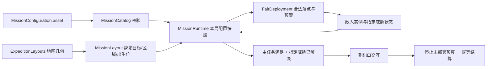
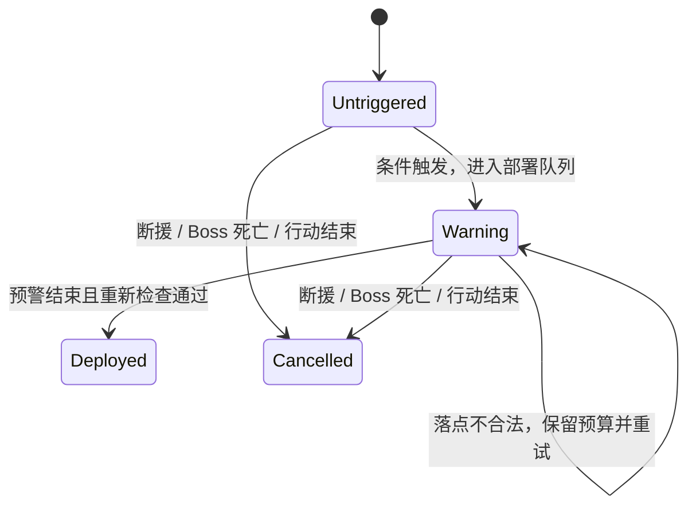

# v0.6 架构与规则

v0.6 将相位行动拆成“主任务、指定威胁、撤离点”，并以十二关共享的小型遭遇编排器连接地图与战斗。当前处于集成验收阶段：已有 Windows 候选构建成功；candidate02 的 Core 44 项与离屏画面流程 80 项通过，任务、存储及路线仍需后续候选复核。后续同一候选的结果以[验收记录](validation.zh-CN.md)为准。

## 从配置到一局行动

运行入口是 [DemoGame.cs](../Game/Assets/_SwapHunter/Scripts/DemoGame.cs)。[ExpeditionData.cs](../Game/Assets/_SwapHunter/Scripts/ExpeditionData.cs) 保留章节 0—11、武器解锁、永久成长和结算；[ExpeditionRun.cs](../Game/Assets/_SwapHunter/Scripts/ExpeditionRun.cs) 负责部署、背包、交互和离场。

实际任务数据来自 [MissionConfiguration.asset](../Game/Assets/_SwapHunter/Resources/MissionConfiguration.asset)，通过 `Resources.Load` 读取；缺失或不合法时明确报错，不静默退回代码默认值。`MissionCatalog.Defaults` 只供首次显式准备资产和校验参考使用。开始行动时深拷贝定义，Inspector 中的后续编辑不会改变进行中的这一局。

配置可调整人数、角色、指定必清、触发条件、预警和提示。稳定章节 ID、目标/遭遇 ID 与地图绑定是一份合同；新增区域、出生位或目标仍需修改 [ExpeditionLayouts.cs](../Game/Assets/_SwapHunter/Scripts/ExpeditionLayouts.cs) 和绑定代码。这不是任意任务图编辑器，也没有将几何布局全部数据化。

## 遭遇预算与撤离

[MissionRuntime.cs](../Game/Assets/_SwapHunter/Scripts/MissionRuntime.cs) 为每一个计划出现的敌人保存独立预算状态：

`Deployed` 表示曾成功生成实例；击败状态另行判断，不把死敌重新变成未触发预算。取消只作用于未触发和预警中的成员，不删除已部署活敌。Boss 死亡的取消检查先于本帧部署倒计时处理，避免过期预警继续生成随从。

触发支持入场、区域到达、目标完成、目标数量、游戏内计时和 Boss 阶段。区域访问与遭遇启动都会锁存；步行、跳跃或 Q 到达都按角色位置检测，回头不会重新刷同一预算。向可见区域开火也可激活该区，实体墙仍阻挡这条射线。

撤离判定是：行动未停止、主目标数达标、指定威胁全部击败、达到本关最少 Q 次数。只有第 1 关要求一次成功 Q。第 1 关的实战守卫、第 2 关两名盾卫和第 12 关 Boss 属于指定威胁；普通活敌、未触发分支和非指定预警预算不统一阻塞撤离。到出口仍须按交互键确认离场。

[FairDeployment.cs](../Game/Assets/_SwapHunter/Scripts/FairDeployment.cs) 检查导航面、净空、占用、与玩家的距离及生成高度。固定高位角色仅在原高度附近找合法点；非法时延期，不降到地面充数。橙色入口有不少于 2.2 秒的实际预警，侧后方至少 3.2 秒。Boss 关的随从上限同时计算预警成员和存活实例，最多两名。

## 双端换位与世界对象

[PlayerMotor.cs](../Game/Assets/_SwapHunter/Scripts/PlayerMotor.cs) 使用 [SwapValidationResult](../Game/Assets/_SwapHunter/Scripts/SwapValidationResult.cs) 返回稳定原因码；HUD 将原因码翻译成中文，日志和 QA 不依赖中文文本比较。原因包括动作/冷却限制、目标无效、超距、视线、落点净空、局部干扰和移动失败；干扰结果附场区 ID。

基线为眼点到目标瞄准点 22 米、3.5 秒基础冷却、0.08 秒准备及终检、敌人约 0.65 秒眩晕。执行时先保存两端位置与玩家速度，关闭角色控制器移动两端并同步物理；目标移动失败时回滚，不扣成功冷却。双方生命、装备和朝向保留；玩家垂直速度归零。蹲伏不会降低换位目的地要求的站立净空。

| 对象 | 已写入的规则 | 不包含的能力 |
|---|---|---|
| [局部干扰场](../Game/Assets/_SwapHunter/Scripts/PhaseInterferenceField.cs) | 固定球形区域，检查玩家和目标的脚部位置；预备结束再次检查 | 射线从场区中间穿过本身不额外禁 Q；不禁用枪械或走路 |
| [锚点接入座](../Game/Assets/_SwapHunter/Scripts/PhaseAnchorSocket.cs) | 存活锚点进入半径后锁存完成，只调用一次目标回调 | 接入后锚点仍可移动，不是永久固定传送门 |
| [维护复位](../Game/Assets/_SwapHunter/Scripts/AnchorMaintenanceReset.cs) | 先检查全部原位与附属碰撞体，再复位任务锚点；失败回滚 | 不移动玩家，不回退接入进度，不刷新奖励或大跳次数 |
| [受击任务物](../Game/Assets/_SwapHunter/Scripts/DamageableObjective.cs) | 接收实际枪击、爆炸或近战；归零后锁存，关闭碰撞并通知任务 | 不是 `SwapTarget`，不计为敌人击杀，不靠 E 假装摧毁 |

已投出的手雷、已展开的 A 盾和已经锁定的危险区域留在世界位置。敌人被换到新区后重新确定活动区域；固定岗位不是换位免疫，也不会把敌人瞬移回旧岗位。

## 状态、存储与对象清理

战术背包进入暂停状态。任务计时和部署更新都检查 `IsPlaying`，不会在背包里偷偷继续倒计时。目标完成先锁存再通知门桥和遭遇；重复交互不会重复发奖。

| 持久化对象 | 保留的身份与失败语义 |
|---|---|
| 相位行动 `expedition-v4.json` | 保留稳定章节和成长索引；用 `runId`/收据阻止重复结算；先成功落盘再更新内存；结算失败锁定结果供重试 |
| 旧战役 `campaign-v3.json` | 保留独立模式与档案；既有故障、备份和幂等检查由 `CampaignDataQA` 复用 |
| 设置 `settings-v5.json` | 新存储实现使用同目录临时文件、刷新磁盘和原子替换；验证 `.bak` 后恢复并保留损坏原件，继续支持 v4/v2 迁移；须在 Storage 原生检查中验收 |
| QA 档案 | [RunStorage.cs](../Game/Assets/_SwapHunter/Scripts/RunStorage.cs) 使用每次新建的隔离根和检查点；设置 QA 不读取玩家 `PlayerPrefs` |

离场先停止任务并取消待部署成员，再撤销预警、停用并销毁敌人/效果/地图。干扰场和受击任务物在禁用时移出各自静态注册表；枪械表现组件释放自己创建的枪口 Mesh。

[RuntimeNavigationOwner](../Game/Assets/_SwapHunter/Scripts/RuntimeNavigationOwner.cs) 只接管刚在运行时生成的 `NavMeshData`。地图销毁时取消可能仍在进行的导航更新、移除导航实例并销毁自有数据；经典地图只是暂时禁用时保留数据，重新启用后可以恢复导航。`NavMeshSurface.RemoveData()` 只移除实例，不销毁数据，因此不能把组件失活当作资源已释放。共享的磁盘烘焙资产不交给这个组件。

## 弹丸复用的边界

[唯一的弹丸生成/退役入口](../Game/Assets/_SwapHunter/Scripts/Presentation.cs) 保留原有运动、碰撞和伤害流程。[BoltPool](../Game/Assets/_SwapHunter/Scripts/BoltPool.cs) 用一个当前效果域下的栈保存闲置对象，复用根对象、弹芯和尾线。每次激活前重新设置伤害、来源、速度、寿命、位置、朝向、颜色和轨迹起点；退役立即停用并清除上次来源。

空闲保留上限为 256。现有 Boss 全向火力每轮 25 发，约 2 秒内通常有 9 轮，因此先给约 225 发的单次技能容量留出余量。上限只限制归还后的闲置对象；不足时继续创建活弹，不能用丢弹制造优化。退出章节销毁整个池，避免上一关的敌人引用和待销毁弹丸进入下一关。

这里采用专用组件和 `Stack<Bolt>`，是因为对象类型和生命周期都固定；若将来需要多种可池化效果，再评估 Unity `ObjectPool<T>` 的统一接口。当前不扩大为通用资源管理框架。固定夹具先测基线，再用未修改的同一生成测量比较暖池后的创建数和托管分配事件；真实伤害、寿命、容量溢出与跨关清理由独立回归验证。具体数据及范围见[验收记录](validation.zh-CN.md)，这些指标不替代前台帧率。

## 工程与验证入口

- [Check-Project-v06.ps1](../Tools/Check-Project-v06.ps1)：无需 Unity 许可证的依赖、链接、包锁、GUID/节点与配置检查。
- [Prepare-Demo-v06.ps1](../Tools/Prepare-Demo-v06.ps1)：显式准备源资产与入口场景；任务配置只在缺失时创建，已有编辑保留。
- [Build-Demo-v06.ps1](../Tools/Build-Demo-v06.ps1)：读取现有源资产构建，不隐式准备；拒绝覆盖旧输出，记录构建前后源输入和程序集身份。
- [Validate-Demo-v06.ps1](../Tools/Validate-Demo-v06.ps1)：Core/Missions/Routes/Storage/Gunplay 验证规则；Pool/Lifecycle/BossEscape 检查复用、释放与逃生路线；Visual 为原生离屏画面，Performance 须另选前台。旧 Legacy 套件不替代新规则验收。

离线编译、状态夹具、真实角色路线、画面检查、性能采样和真人首通是不同证据。十二关保底路线已有同构建自动验证，战斗节奏与数值仍需初见玩家的实际体验反馈。详见[遭遇说明](encounters-v06.zh-CN.md)和[验收记录](validation.zh-CN.md)。

项目使用 AI 辅助编程、程序化资产制作、测试脚本及文档整理；不将 AI 目视复核称为真人专家验收，也未使用真人动捕。第三方组件和原创素材范围见[资源声明](../THIRD_PARTY_NOTICES.md)。

