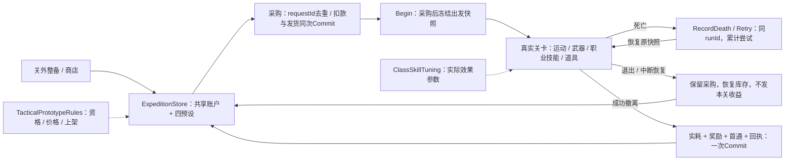

# 四职业系统设计与证据入口

本文描述已接入源码的 D1.1 系统边界。构建、原生专项、路线、画面和性能结果统一见[本轮验证记录](tactical-validation.zh-CN.md)；这里不预填通过数量。

## 账户与一场行动

共享账户保存信用点、拥有资产、库存、章节和首通；`ClassLoadout[4]` 分别保存职业双枪、每枪配件、职业/通用技能与两道具槽。上架、拥有、职业可用、已装备是四个不同判断，避免切职业复制资产或把通关上架误当免费发货。枪械没有新增品质或升级等级。



运行中只减少携带计数，永久库存保持快照基线。这样死亡重试不会重复收费；成功时才按三种实际消耗写入库存。快照同时冻结枪、配件、技能与等级，防止途中状态读取到关外新配置。`RequireIdle` 在数据操作入口锁住采购、换职业和改装，不只依赖UI灰按钮。

每次保存先修改副本，写临时文件、Flush并替换主文件/备份，成功后才交换内存对象。采购回执按“请求编号＋商品＋数量”去重；行动回执按runId去重。它是本地单档事务设计，不宣称分布式事务或任意硬件故障下绝对不丢数据。

## 关键取舍

- Q 保持共享的空间规则；职业技能提供控制、机动、信息、装填和区域管理，不出售 Q 能力。扫描只扩展信息，不绕过 Q 的遮挡与双端占位检查。
- 八项职业技能各自三级，同职业两项独立购买。盾/刀共享拥有、通用槽互斥；刀一级即含召回。普通减伤后先扣护甲再扣生命，空间/环境伤害走独立类别，避免成长绕过场景机制。
- 关卡目标和遭遇保持 `MissionConfiguration` 数据入口；任务满足不等于清光敌人。地图碰撞、永久路线与视觉子树分离，外观调整不偷偷改变落脚或生成第二套伤害。
- 新普通流程使用 `Expedition-Tactical-v6/expedition-v6.json`，不自动读取v4/v5。演示/QA走隔离根；演示预置和真实通关记录分开。
- 价格集中在规则类，四职业逐章现金流通过生产交易接口生成。账面上存在不刷关、不做可选的培养路线，不能由此推导真人难度已平衡。

| 边界 | 源码入口 / 关键接口 |
|---|---|
| 账户、资格、事务 | [ExpeditionData.cs](../Game/Assets/_SwapHunter/Scripts/ExpeditionData.cs)：SelectClass、Claim*Starter、Buy*、UpgradeSkill、Begin/Retry/Settle |
| 规则与经济 | [TacticalPrototypeRules.cs](../Game/Assets/_SwapHunter/Scripts/TacticalPrototypeRules.cs)、[经济路径说明](tactical-economy.zh-CN.md) |
| 运行接线 | [ExpeditionRun.cs](../Game/Assets/_SwapHunter/Scripts/ExpeditionRun.cs)：部署、死亡待提交、三道具实耗、撤离 |
| 技能、区域与伤害 | [PlayerClassSkill.cs](../Game/Assets/_SwapHunter/Scripts/PlayerClassSkill.cs) 内ClassSkillTuning；[ClassSkillEffects.cs](../Game/Assets/_SwapHunter/Scripts/ClassSkillEffects.cs)、[PlayerMotor.cs](../Game/Assets/_SwapHunter/Scripts/PlayerMotor.cs) |
| 商店与真实模型 | [ExpeditionUI.cs](../Game/Assets/_SwapHunter/Scripts/ExpeditionUI.cs)、[WeaponLibraryUI.cs](../Game/Assets/_SwapHunter/Scripts/WeaponLibraryUI.cs)、WeaponModelPreview.cs |
| 章节 / 敌人 / Boss | [MissionRuntime.cs](../Game/Assets/_SwapHunter/Scripts/MissionRuntime.cs)、EnemyTacticalAI.cs、BossSpatialSkills.cs |
| 模式隔离 | [RunStorage.cs](../Game/Assets/_SwapHunter/Scripts/RunStorage.cs)、TacticalDemoProfile.cs、DemonstrationMode.cs |

## 验证分层与外观来源

`TacticalStorageChecks` 覆盖共享资产、独立预设、采购和三库存事务、合成旧档迁移及四职业现金流；`TacticalSkillChecks` 检查技能与现有武器/Q/伤害交互。原生专项由 `TacticalCampaignQA` 汇总。路线夹具使用真实输入和PlayerMotor走路，但允许清敌和特定Boss夹具；它只证明定义范围内的路线。离屏UI图和图像检查、前台交互、性能采样、初见观察分别记录，不能相互替代。

本轮实际接入5项 Quaternius 模块与3张 Kenney 特效纹理；来源、原包与文件哈希、实际许可见[资源台账](../THIRD_PARTY_ASSETS.md)和[机器清单](../THIRD_PARTY_ASSETS.json)。自有枪械、身体/敌人/Boss节点动画继续保留，`D11SceneVisuals`、`D11EnemyAccents`负责既有场景的视觉绑定和辨识附件。已取得但未采用的机甲动画不算游戏成果；CC0作者资产也不写成项目原创。

## 旧档副本预览

以下工具只处理用户明确选择的副本；输出目录必须全新。它启动对应玩家的后台纯预览入口，不进入正常Profile初始化。

```powershell
python Tools/preview_tactical_migration.py --copy "C:/review/old-copy.json" --executable "C:/player/SwapHunter.exe" --output "C:/review/new-preview"
```

v4 中旧刀0/1/2/3映射新1/2/3/3，旧盾映射1；实际旧专精投入S、取消召回门槛投入D、兑换率r不明时列入 `UnknownHistory`，不能用当前价目倒推成已核实支出。T01 v5已使用信用点，余额/已购医疗库存原值映射，不补发提高后的首通奖励。

审阅明确后可加 `--approved-candidate` 仅生成候选副本；v4还需按真实证据提供 `--exchange-rate`、`--verified-specialization-spend`、`--verified-recall-spend`。`TacticalMigrationPreview.Preview/BuildCandidate` 没有正式导入写盘方法。候选保留历史回执来源标记；实际导入仍须另行确认、备份与幂等导入流程。
## 源码可复现性修复

独立目录首次还原时，Unity MCP 的 GitHub Git 拉取发生连接重置，导致构建在依赖解析阶段退出。现保留同一个10.3.0、固定提交aa5fc638d623f56178d50329d9ad8c541a57fe66，将官方包及其MIT许可放入Dependencies，manifest使用本地相对路径，传递依赖不变。

构建输入清单同时包含Dependencies。与已验收试玩版相比，玩法/资产/设置文件逐项保持相同；源码包明确记录仅编辑器工具依赖来源的差异及自身构建身份，旧报告没有改写。Unity官方包仍由Package Manager正常还原，不宣称完全离线构建。来源文件与哈希见Dependencies/unity-mcp-source.json。
